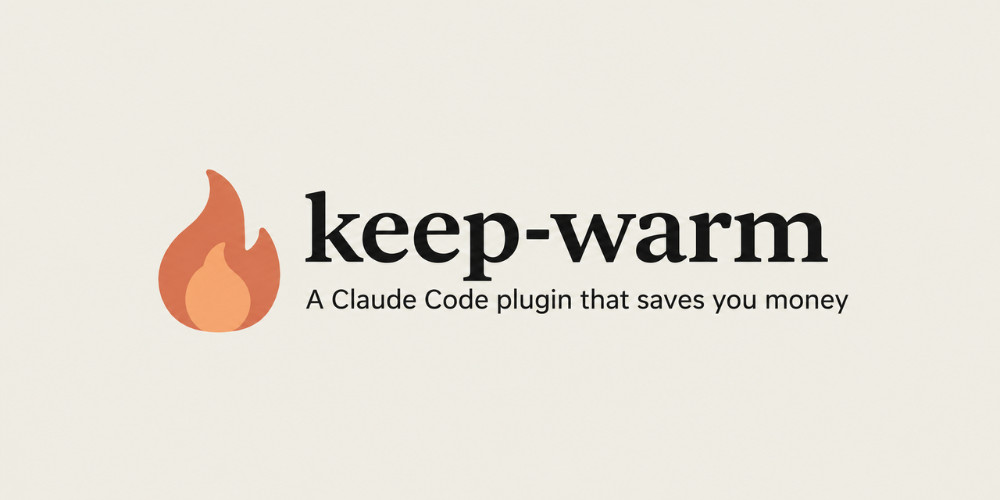
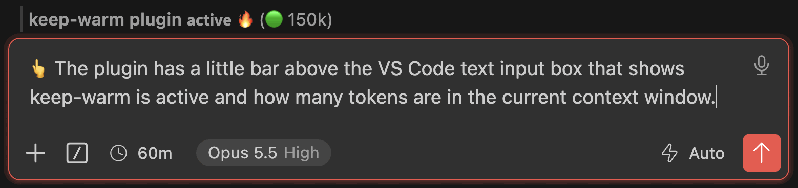
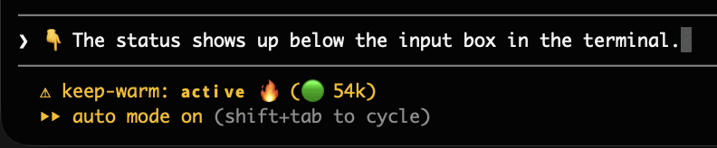

## How it works

Type `warm` in any thread to keep the cache warm when you step away. Keep-warm sends a ping after 50 quiet
minutes, and Claude replies "ok" and the cache stays warm. Every message restarts the cache's one-hour timer, so
each ping buys another hour for the price of a cheap cache read. Without it, the timer runs out and your next
message writes the whole thread again, at 20-80× the price depending on the model. Type `warm list` to see all
your currently active threads, along with their token count.





## Why: the cache goes cold

Step away for lunch and Claude's cache goes cold. Come back and you pay to remind it of everything, at 80× the
price on Fable. That's $8 just to say "hi."

Claude caches your conversation for one hour. Come back within the hour and your next message re-reads the cache,
which is cheap. Come back later and the whole thread is written into the cache again, at 80 times the price on
Fable 5.2 (40 times on Opus 5.5). The bigger the thread, the more a cold return costs.

A cold read (the cache has lapsed, so the whole thread gets written again) costs $16 per million tokens on Fable
5.2 and $8 per million on Opus 5.5:

| Context | Fable 5.2 cold | Opus 5.5 cold | Warm read (either) | Keep-warm w/ Fable buys you |
| --- | --- | --- | --- | --- |
| 🟢 200k | $3.20 | $1.60 | $0.04 | a coffee |
| 🟢 300k | $4.80 | $2.40 | $0.06 | a croissant |
| 🟡 400k | $6.40 | $3.20 | $0.08 | a latte |
| 🟠 500k | $8.00 | $4.00 | $0.10 | a sandwich |
| 🔴 600k | $9.60 | $4.80 | $0.12 | a smoothie |
| 🔴 700k | $11.20 | $5.60 | $0.14 | a burrito |
| 🔴 800k | $12.80 | $6.40 | $0.16 | a burger |
| 🔴 900k | $14.40 | $7.20 | $0.18 | a cocktail |
| 🔴 1M | $16.00 | $8.00 | $0.20 | a movie ticket |

Those costs are for a single cold-cache read. Imagine how many times this happens in a day. Or better yet,
don't... just use the plugin 🤓

> You work in Fable 5.2, walk away for an hour, and come back with a 400k context. A few hours later you do the
> same at 500k, then again at 600k. Then you switch from Fable to Opus without compacting. That costs $28.80. With
> keep-warm, and compacting before switching from Fable to Opus, it costs $2.70.

$26 back in your pocket. Same work.

## What you type

None of these reach Claude, so they're free. Talk to the plugin all you want.

| Type | What happens |
| --- | --- |
| `warm` | keep-warm on for this thread |
| `cold` or `cool` | keep-warm off for this thread |
| `warm list` | every warm thread, in any window: model, size, idle time, project, name, and money saved so far |
| `cool 2` or `cool 2 4` | switch off those threads from the last list |
| `tokens` | one line: size, cost to re-read, cost if the cache lapses, minutes left on the cache |
| `/warm-line` | hide or show the bar |

## The bar

- **`active 🔥 (🟢 112k)`**: keep-warm is on. The number is the thread's size in tokens.
- **`back burner (🟢 82k)`**: keep-warm is off, which is how every new thread starts. Simmering, not burning money. The size still shows.

The dot shows when it's worth compacting:

| Dot | Size | What it means |
| --- | --- | --- |
| 🟢 | up to 300k | fine |
| 🟡 | 300k to 400k | consider a `/compact` at a natural break |
| 🟠 | 400k to 500k | a compact pays for itself within about 20 requests |
| 🔴 | over 500k | compact now. Seriously. |

## How it behaves

- It pings only after 50 minutes with no activity, never while you're working.
- It switches itself off after 24 hours without a message from you.
- `warm list` counts money honestly. Each ping is subtracted at what it actually cost. Each time you come back
  after more than an hour to a cache that a ping kept warm, the rewrite you skipped is added. A thread you never
  come back to shows as a loss.
- Every model has its own cache, so `/compact` before switching models, and before stepping away from a big
  thread.

## Install

**The easy way: ask Claude.** Paste this into Claude Code:

> Install the keep-warm plugins from https://github.com/Sonified/keep-warm

**For the agent doing the install:** run these three commands in a shell.

```
claude plugin marketplace add Sonified/keep-warm
claude plugin install keep-warm@keep-warm
claude plugin install tokens@keep-warm
```

If `claude` is not on the PATH (a VS Code-only setup), use the copy inside the extension:
`ls -d ~/.vscode/extensions/anthropic.claude-code-*/resources/native-binary/claude | sort -V | tail -1`

Then tell the person to type `/reload-plugins` (or open a new Claude Code window) and then `warm`. The bar above
the input box should read `active 🔥`. Do not type `warm` for them: only a message the person types switches it on.

**By hand,** in Claude Code in a terminal:

```
/plugin marketplace add Sonified/keep-warm
/plugin install keep-warm@keep-warm
/plugin install tokens@keep-warm
/reload-plugins
```

Needs `bash` and `python3`. Built on macOS, and tested in the VS Code extension and in the terminal. Prices are
list prices per million tokens; your plan may differ. State lives in `~/.claude/keep-warm/`.

## What I learned building this

1. **Each model has its own cache.** Switching models mid-thread rewrites everything. For lighter work, lower the
   effort instead. If you do switch, compact first.
2. **Every tool call re-reads the whole thread.** Each one is its own request, so a message where Claude runs 10
   commands pays for the thread 10 times (calls sent together in one step count as one). Thread size matters most
   during tool-heavy work.
3. **One cold read costs the same as 80 warm ones** on Fable (40 on Opus), at any thread size.
4. **Compacting costs about the same at 200k as at 600k**, as long as the cache is warm. Compact before you step
   away, not after you come back. Once the cache has gone cold (an hour with no messages), the compact itself has
   to pay to rewrite the whole thread before it can shrink it.

---

***Winter is coming ❄️⛄️ keep warm 🔥***
